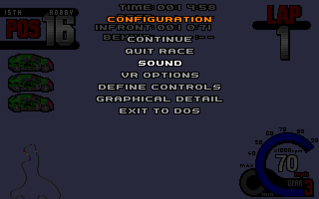
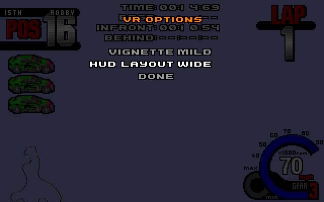
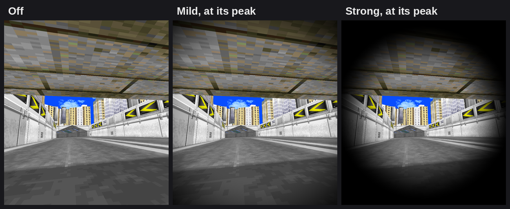
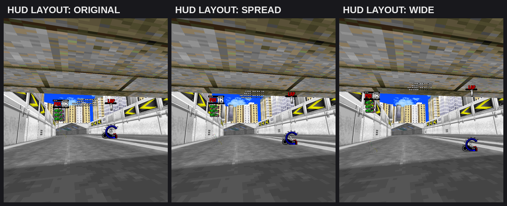

# ROLLER VR

[![Release][rel-shd]][rel-url] [![License][lc-shd]][lc-url]


Cockpit VR for Whiplash / Fatal Racing (1995). This is a fork of
[ROLLER](https://github.com/FatalDecomp/ROLLER), the open-source
reimplementation of the game that runs on modern PCs, with an
[OpenXR](https://www.khronos.org/openxr/) mode added. You sit in the car, look
around with your head and drive with the headset's controllers, a wheel, a
gamepad or the keyboard.

ROLLER was created by [Zizin13](https://github.com/Zizin13) and is developed by
the [FatalDecomp](https://github.com/FatalDecomp) contributors. The VR mode sits
on top of their work; see [Credits](#credits).

## What it adds

- A stereo cockpit view. Both eyes use the headset's head pose and field of
  view, scaled from the car's hitbox to real-world size. The whole track is
  drawn, so far scenery that the flat game culls stays visible.
- Menus and HUD in the headset. The menu screens, including the pause menu,
  float in front of you; the HUD is locked to your head. The menu is mirrored in
  a small desktop window.
- Controller driving through OpenXR for the Valve Steam Frame, Oculus Touch and
  simple controller profiles. Gamepads, wheels and keyboards plugged in before
  you start work too.
- Screenshots: click both thumbsticks to save both eye images plus the HUD or
  menu picture.
- A VR OPTIONS page in the pause menu: an optional comfort vignette and a choice
  of where the HUD sits.

The VR code is only compiled with `-Dvr`, so a plain `zig build` still gives you
the normal desktop game.

## Status

Early release, tested on one setup: Windows 11, SteamVR 2.17-2.18 and a Steam
Frame with its controllers. Graphics, head tracking, menus, driving, sound, the
pause menu and screenshots work there. The Touch and simple-controller bindings
are in but untried on real hardware, and other headsets and OpenXR runtimes
should work in principle but are untested. On Linux the same code runs against
[Monado](https://monado.freedesktop.org/), which is how it is tested without a
headset. Upstream's newer online multiplayer is in the code but untried in VR.

## Quick start (Windows)

You need your own copy of Whiplash / Fatal Racing. Nothing from the game is
included.

1. Download `roller-vr-<version>-windows.zip` from the
   [releases](https://github.com/BoulderM/ROLLER-vr/releases) page and extract
   it to a normal drive folder, for example `C:\Games\Fatal`. The game writes
   its log and settings next to the executable.
1. Make SteamVR the active OpenXR runtime: SteamVR > Settings > Developer > "Set
   SteamVR as OpenXR runtime".
1. Copy the contents of the `FATDATA` folder from your disc into a new folder
   called `fatdata` next to `roller-vr.exe`.
1. Start SteamVR, then run `RUN-VR.bat`. `RUN-VR-DEMO.bat` starts the
   attract-mode demo instead of the menu.

From a command line,
`roller-vr --vr --whiplash-root <folder containing fatdata>` does the same. On
first run the game binds player 1 to the VR controller in `ROLLER.INI` (six
lines; the original is saved once as `ROLLER.INI.bak`).

The retail `FATAL.INI` has sound effects and music switched off. If you hear
nothing, pause and switch them on under SOUND.

## Controls

With the Steam Frame controllers. Gamepads and wheels use the same layout.

| Input                         | Action                                               |
| ----------------------------- | ---------------------------------------------------- |
| Left stick                    | Steer                                                |
| Right trigger                 | Accelerate (hold it fully, see below)                |
| Left trigger                  | Brake                                                |
| Left / right shoulder or grip | Shift down / up (the gearbox is automatic otherwise) |
| Menu (Start)                  | Pause menu; D-pad and A navigate, Menu resumes       |
| View + Menu, held 2 s         | Quit from anywhere (Menu alone without View)         |
| Both thumbstick clicks        | Save a screenshot to `screenshots/`                  |

After GO the engine needs about a second before the car moves, so keep the right
trigger fully down. A short or light pull may not get the car going.

## VR options

Pause the game and pick VR OPTIONS, between SOUND and DEFINE CONTROLS. D-pad up
and down pick a row, left, right or A change it, B goes back. Changes apply
straight away and are saved in `roller-vr.ini` next to the executable
(`vignette=off|mild|strong`, `hud=original|spread|wide`), which you can also
edit by hand.





Screenshots from the game.

### Vignette

Off by default. If fast racing makes you queasy, the vignette darkens the edges
of your view while the car's view is turning hard (corners, ramps, loops) and
fades out again afterwards. Turning your own head doesn't trigger it. While the
page is open it shows at full strength, so you can see what each level does.



Illustration, about 90 degrees of view assumed.

### HUD layout

The game draws its HUD as one sheet, which floats in front of you. SPREAD and
WIDE cut it into its five parts (position, timer, lap, minimap, speedometer) and
move them out towards the edges of your view. Each part keeps its corner and its
size, so the middle stays clear. The pause menu is always one sheet.

| Layout   | What it does                                 |
| -------- | -------------------------------------------- |
| ORIGINAL | The sheet as the game draws it (the default) |
| SPREAD   | The parts 1.5 times further from the centre  |
| WIDE     | The parts twice as far from the centre       |



Illustration, about 90 degrees of view assumed.

## Command line

| Option                  | Effect                                          |
| ----------------------- | ----------------------------------------------- |
| `--vr`                  | Run in VR; boots to the main menu               |
| `--whiplash-root <dir>` | Folder that contains `fatdata`                  |
| `--vr-demo`             | Start the attract-mode demo instead of the menu |
| `--vr-frames N`         | Quit after N frames (for tests)                 |

The other `--vr-*` options (`--vr-fake-input`, `--vr-fake-head`,
`--vr-eye-dump-dir` and so on) are test hooks for headset-free runs.

## Building from source

You need [Zig 0.15.2](https://ziglang.org/download/) (`mise install` sets it
up).

```bash
git clone https://github.com/BoulderM/ROLLER-vr.git
cd ROLLER-vr
```

- Linux: `zig build -Dvr -Doptimize=ReleaseSafe`. This needs the OpenXR loader
  and Vulkan development packages (`libopenxr-dev`, `libvulkan-dev`).
- Windows, cross-built from Linux: set `OPENXR_SDK_PATH` to an extracted
  OpenXR-SDK release (`include/` and `lib/openxr_loader.lib`) and `VULKAN_SDK`
  to a Vulkan SDK (`Include/`, `Lib/vulkan-1.lib`), then run
  `zig build -Dvr -Dtarget=x86_64-windows-gnu -Doptimize=ReleaseSafe`. Put
  `openxr_loader.dll` next to the executable.

Always pass `-Doptimize`. The default Debug build runs with sanitizers and is
far too slow for VR.

The VR build uses a patched SDL
([BoulderM/SDL](https://github.com/BoulderM/SDL), branch `vr-gpu-properties`)
that exposes SDL_GPU's Vulkan device so OpenXR can bind to it. Zig fetches it
automatically, and only for `-Dvr`.

Tests that need no headset, GPU or game data:

```bash
zig build test-vr-pure
zig build -Dvr test-vr-sdl
```

For the flat game, the browser build and the reverse-engineering notes, see the
[upstream README](https://github.com/FatalDecomp/ROLLER#readme).

## How it works

OpenXR's `XR_KHR_vulkan_enable` needs the Vulkan handles, and SDL_GPU doesn't
expose them. The patched SDL adds `SDL_GetGPUDeviceProperties()`,
`SDL_GetGPUTextureProperties()` and an `SDL_GPUVulkanOptions` hook, so OpenXR
binds to the device SDL_GPU already owns and the game keeps its renderer.

- `vr_runtime.c` runs the OpenXR session. Each frame it renders two windowless
  `scene_render_gpu` passes, one per eye, and copies them into the projection
  swapchains.
- `vr_camera_compose.c` builds the game's camera from the head pose inside
  `calculateview()`. Only the per-eye asymmetric projection is kept from the VR
  matrices.
- `vr_quad.c` composes the menu, HUD and vignette quad layers the same way, one
  swapchain each.
- `vr_input*.c` maps OpenXR actions to a virtual SDL gamepad.

The VR sources are `PROJECTS/ROLLER/vr_*.c`. The rest of the tree is ROLLER.

## Relationship to upstream

This is a separate repository, not a GitHub fork. The default branch,
`roller-vr`, is ROLLER's `master` plus the VR work. Upstream is merged in
regularly (last sync 2026-10-18, up to upstream commit `d5b1221`). The plan is
to offer the VR work upstream at some point, once its history is tidied up.

Please report VR problems in this repository's
[issues](https://github.com/BoulderM/ROLLER-vr/issues) and attach
`roller-vr.log`; upstream's tracker doesn't cover this fork. The log is written
next to the executable (or in `%APPDATA%\ROLLER\roller-vr` if that folder isn't
writable) and lists the OpenXR runtime, the controller profile it picked and the
audio settings.

## Made with Claude Code

The VR mode was written with [Claude Code](https://claude.com/claude-code), with
the repository owner setting the goals and testing on a headset. The ROLLER code
underneath is upstream's.

## Credits

- ROLLER was created by [Zizin13](https://github.com/Zizin13) and is developed
  by the [FatalDecomp](https://github.com/FatalDecomp) community, among them
  [deevus](https://github.com/deevus), [schlangz](https://github.com/schlangz),
  [ricaun](https://github.com/ricaun),
  [aspirations04](https://github.com/aspirations04) and the other
  [contributors](https://github.com/FatalDecomp/ROLLER/graphs/contributors).
  Everything that makes the game run is their work; this fork adds the VR layer.
  Upstream is at <https://github.com/FatalDecomp/ROLLER>, the game's site is
  <https://fatal.racing/> and there is a browser version at
  <https://play.fatal.racing/>.
- Whiplash / Fatal Racing was developed and published by Gremlin Interactive in
  1995 (published as Whiplash by Interplay Productions in North America in
  1996). Game design by Les Spink and Ade Carless. The game assets belong to
  their owners; this project ships none of them.
- SDL is by the [SDL project](https://github.com/libsdl-org/SDL), built with the
  Zig build system through [castholm's port](https://github.com/castholm/SDL)
  and [Zizin13's fork of it](https://github.com/Zizin13/SDL) that ROLLER pins.
  The VR patches sit on top of that fork.
- OpenXR is by the [Khronos Group](https://www.khronos.org/openxr/); the VR code
  is written against the spec and the Khronos `hello_xr` sample.
  [Monado](https://monado.freedesktop.org/) (Collabora and contributors) made
  headset-free testing possible.

### Dependencies

- SDL 3.2.22: <https://github.com/libsdl-org/SDL>
- SDL_image 3.2.4: <https://github.com/libsdl-org/SDL_image>
- WildMIDI 0.4.6: <https://github.com/Mindwerks/wildmidi>
- libcdio 2.3.0: <https://github.com/libcdio/libcdio>
- Nuklear 4.13.2: <https://github.com/Immediate-Mode-UI/Nuklear>
- OpenXR SDK loader and Vulkan, for `-Dvr` builds only

## License

GPLv3, inherited from ROLLER; see [LICENSE.md](LICENSE.md). The VR code uses the
same licence.

[lc-shd]: https://img.shields.io/github/license/BoulderM/ROLLER-vr.svg?style=for-the-badge&labelColor=black
[lc-url]: https://github.com/BoulderM/ROLLER-vr/blob/roller-vr/LICENSE.md
[rel-shd]: https://img.shields.io/github/v/release/BoulderM/ROLLER-vr?include_prereleases&style=for-the-badge&logo=github&label=Download&labelColor=black&color=blue
[rel-url]: https://github.com/BoulderM/ROLLER-vr/releases
