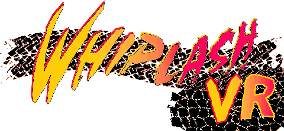

# ROLLER VR

[![Release][rel-shd]][rel-url] [![License][lc-shd]][lc-url]



**Cockpit VR for Whiplash / Fatal Racing (1995).** ROLLER VR is a fork of
[ROLLER](https://github.com/FatalDecomp/ROLLER), the open-source
reimplementation of the game that runs on modern PCs, with an
[OpenXR](https://www.khronos.org/openxr/) mode added. Sit in the car, look
around with your head, and drive with the headset's controllers, a wheel, a
gamepad or the keyboard.

> This project exists because of ROLLER, created by
> [Zizin13](https://github.com/Zizin13) and built out by the
> [FatalDecomp](https://github.com/FatalDecomp) contributors. They reverse
> engineered a 30-year-old DOS game and made it run natively; the VR mode is a
> layer on top of that work. See [Credits](#credits).

## What it adds

- **Real stereo cockpit view.** Both eyes are rendered with the headset's head
  pose and per-eye field of view, scaled from the car's hitbox to real-world
  size. The whole track is drawn in VR, so far scenery that the flat game culls
  stays visible.
- **Menus and HUD in the headset.** The menu screens, including the pause menu,
  float in front of you as a quad layer; the HUD is a head-locked quad layer.
  The menu is also mirrored in a small desktop window.
- **Controller driving.** OpenXR actions for the Valve Steam Frame, Oculus Touch
  and simple controller profiles feed a virtual gamepad that player 1 reads.
  Gamepads, wheels and keyboards that are plugged in before you start work too.
- **VR screenshots.** Clicking both thumbsticks saves both eye images plus the
  HUD or menu picture.
- **Comfort vignette.** Optional (off by default): the edges of your view darken
  while the car's view turns hard, in a mild or strong setting.
- **The flat game is still there.** The VR code is compiled only with `-Dvr`, so
  a plain `zig build` produces the normal desktop game.

## Status

An early release, tested on one setup: Windows 11, SteamVR 2.17-2.18 and a Steam
Frame with its controllers. Graphics, head tracking, menus, driving, sound, the
pause menu and screenshots all work there. Touch and simple-controller bindings
are included but have not been tried on real hardware, and other headsets and
OpenXR runtimes should work in principle but are untested. On Linux the same
code runs against [Monado](https://monado.freedesktop.org/), which is how it is
tested without a headset. Upstream's newer online multiplayer is part of the
code but has not been tried in VR.

## Quick start (Windows)

You need your own copy of Whiplash / Fatal Racing; nothing from the game is
included.

1. Download `roller-vr-<version>-windows.zip` from the
   [releases](https://github.com/BoulderM/ROLLER-vr/releases) page and extract
   it to a normal drive folder (for example `C:\Games\Fatal`). The game writes
   its log and settings next to the executable.
1. Make SteamVR the active OpenXR runtime: SteamVR > Settings > Developer > "Set
   SteamVR as OpenXR runtime".
1. Copy the contents of the `FATDATA` folder from your disc into a new folder
   called `fatdata` next to `roller-vr.exe`.
1. Start SteamVR, then run `RUN-VR.bat`. `RUN-VR-DEMO.bat` starts the
   attract-mode demo instead of the menu.

From a command line,
`roller-vr --vr --whiplash-root <folder containing fatdata>` does the same. On
first run the game binds player 1 to the VR controller in `ROLLER.INI` (six
lines, the original is saved once as `ROLLER.INI.bak`).

The retail `FATAL.INI` ships with sound effects and music switched off. If you
hear nothing, pause and switch them on in the SOUND item.

## Controls

With the Steam Frame controllers; gamepads and wheels use the same layout.

| Input                          | Action                                               |
| ------------------------------ | ---------------------------------------------------- |
| Left stick                     | Steer                                                |
| Right trigger                  | Accelerate (hold it fully; see below)                |
| Left trigger                   | Brake                                                |
| Left / right shoulder or grip  | Shift down / up (the gearbox is automatic otherwise) |
| Menu (Start)                   | Pause menu; D-pad and A navigate, Menu resumes       |
| View + Menu, held 2 s          | Quit from anywhere (Menu alone without View)         |
| Both thumbstick clicks         | Save a screenshot to `screenshots/`                  |
| Left thumbstick click (paused) | Cycle the comfort vignette: off, mild, strong        |

After GO the engine needs about a second before the car moves, so keep the right
trigger fully down. A short or light pull may not get the car moving.

## Comfort vignette

Fast racing in VR can make some people feel unwell: the world swings around
while your body sits still. The vignette softly darkens the edges of your view
only while the car's own view is turning hard (corners, ramps, loops) and fades
back out afterwards, which takes away much of the peripheral motion that causes
it. Turning your own head never triggers it.

It is off by default. Pause the game and click the left thumbstick to cycle off,
mild and strong; while the pause menu is open the ring is shown at its darkest
so you can see what the setting does. The choice is saved in `roller-vr.ini`
next to the executable (`vignette=off`, `mild` or `strong`; you can also edit
that file), and setting the environment variable `ROLLER_VR_VIGNETTE` forces a
level for one run.

## Command line

| Option                  | Effect                                          |
| ----------------------- | ----------------------------------------------- |
| `--vr`                  | Run in VR; boots to the main menu               |
| `--whiplash-root <dir>` | Folder that contains `fatdata`                  |
| `--vr-demo`             | Start the attract-mode demo instead of the menu |
| `--vr-frames N`         | Quit after N frames (for tests)                 |

The remaining `--vr-*` options (`--vr-fake-input`, `--vr-fake-head`,
`--vr-eye-dump-dir`, and so on) are test hooks used for headset-free runs.

## Building from source

Needs [Zig 0.15.2](https://ziglang.org/download/) (`mise install` sets it up).

```bash
git clone https://github.com/BoulderM/ROLLER-vr.git
cd ROLLER-vr
```

- **Linux:** `zig build -Dvr -Doptimize=ReleaseSafe`. Needs the OpenXR loader
  and Vulkan development packages (`libopenxr-dev`, `libvulkan-dev`).
- **Windows, cross-built from Linux:** set `OPENXR_SDK_PATH` to an extracted
  OpenXR-SDK release (`include/` and `lib/openxr_loader.lib`) and `VULKAN_SDK`
  to a Vulkan SDK (`Include/`, `Lib/vulkan-1.lib`), then
  `zig build -Dvr -Dtarget=x86_64-windows-gnu -Doptimize=ReleaseSafe`. Ship
  `openxr_loader.dll` next to the executable.

**Always pass `-Doptimize`.** The default Debug build runs with sanitizers and
is far too slow for VR.

The VR build uses a patched SDL
([BoulderM/SDL](https://github.com/BoulderM/SDL), branch `vr-gpu-properties`)
that exposes SDL_GPU's Vulkan device so OpenXR can bind to it. Zig fetches it
automatically, and only for `-Dvr`.

Tests that need no headset, GPU or game data:

```bash
zig build test-vr-pure
zig build -Dvr test-vr-sdl
```

For the flat game, the browser build and the reverse-engineering notes, see the
[upstream README](https://github.com/FatalDecomp/ROLLER#readme).

## How it works

SDL_GPU does not expose its Vulkan handles, which OpenXR's
`XR_KHR_vulkan_enable` needs. The patched SDL adds
`SDL_GetGPUDeviceProperties()`, `SDL_GetGPUTextureProperties()` and an
`SDL_GPUVulkanOptions` hook, so OpenXR binds to the device SDL_GPU already owns
and the game keeps its renderer.

- `vr_runtime.c` runs the OpenXR session. Each frame it renders two windowless
  `scene_render_gpu` passes, one per eye, and copies them into the projection
  swapchains.
- `vr_camera_compose.c` builds the game's camera from the head pose inside
  `calculateview()`; only the per-eye asymmetric projection is kept from the VR
  matrices.
- `vr_quad.c` composes the menu and HUD quad layers the same way, one swapchain
  each.
- `vr_input*.c` maps OpenXR actions to a virtual SDL gamepad.

The VR sources are `PROJECTS/ROLLER/vr_*.c`; the rest of the tree is ROLLER.

## Relationship to upstream

This repository is a separate repository, not a GitHub fork. The `roller-vr`
branch carries the VR work on top of ROLLER's `master` and is the default branch
here. Upstream is merged in regularly; the last sync was on 2026-10-18, up to
upstream commit `d5b1221`. The VR work is meant to be offered to upstream
eventually; until its history is cleaned up for that, it lives here.

Please report problems with the VR mode in this repository's
[issues](https://github.com/BoulderM/ROLLER-vr/issues) and attach
`roller-vr.log`; upstream's tracker does not cover this fork. The log is written
next to the executable (or in `%APPDATA%\ROLLER\roller-vr` if that folder is not
writable) and lists the OpenXR runtime, the controller profile the runtime
picked and the audio settings.

## Made with Claude Code

The VR mode was written with [Claude Code](https://claude.com/claude-code),
Anthropic's AI coding assistant, working under the direction of the repository
owner, who set the goals and tested the builds on a real headset. The ROLLER
code underneath is upstream's work.

## Credits

- **ROLLER**, the reimplementation this is built on, was created by
  [Zizin13](https://github.com/Zizin13) and is developed by the
  [FatalDecomp](https://github.com/FatalDecomp) community, among them
  [deevus](https://github.com/deevus), [schlangz](https://github.com/schlangz),
  [ricaun](https://github.com/ricaun),
  [aspirations04](https://github.com/aspirations04) and the other
  [contributors](https://github.com/FatalDecomp/ROLLER/graphs/contributors).
  Everything that makes the game run is their work; this fork only adds the VR
  layer. Upstream project: <https://github.com/FatalDecomp/ROLLER>, with the
  game at <https://fatal.racing/> and a browser version at
  <https://play.fatal.racing/>.
- **Whiplash / Fatal Racing** was developed and published by Gremlin Interactive
  in 1995 (published as Whiplash by Interplay Productions in North America in
  1996). Game design by Les Spink and Ade Carless. All game assets remain the
  property of their owners; this project ships none of them.
- **SDL** by the [SDL project](https://github.com/libsdl-org/SDL), built with
  the Zig build system through
  [castholm's port](https://github.com/castholm/SDL) and
  [Zizin13's fork of it](https://github.com/Zizin13/SDL) that ROLLER pins. The
  VR patches are applied on top of that fork.
- **OpenXR** by the [Khronos Group](https://www.khronos.org/openxr/); the VR
  code is written against the spec and the Khronos `hello_xr` sample. **Monado**
  by [Collabora and contributors](https://monado.freedesktop.org/) made
  headset-free testing possible.

### Dependencies

- SDL 3.2.22: <https://github.com/libsdl-org/SDL>
- SDL_image 3.2.4: <https://github.com/libsdl-org/SDL_image>
- WildMIDI 0.4.6: <https://github.com/Mindwerks/wildmidi>
- libcdio 2.3.0: <https://github.com/libcdio/libcdio>
- Nuklear 4.13.2: <https://github.com/Immediate-Mode-UI/Nuklear>
- OpenXR SDK loader and Vulkan, for `-Dvr` builds only

## License

GPLv3, inherited from ROLLER; see [LICENSE.md](LICENSE.md). The VR code is
released under the same licence.

[lc-shd]: https://img.shields.io/github/license/BoulderM/ROLLER-vr.svg?style=for-the-badge&labelColor=black
[lc-url]: https://github.com/BoulderM/ROLLER-vr/blob/roller-vr/LICENSE.md
[rel-shd]: https://img.shields.io/github/v/release/BoulderM/ROLLER-vr?include_prereleases&style=for-the-badge&logo=github&label=Download&labelColor=black&color=blue
[rel-url]: https://github.com/BoulderM/ROLLER-vr/releases
